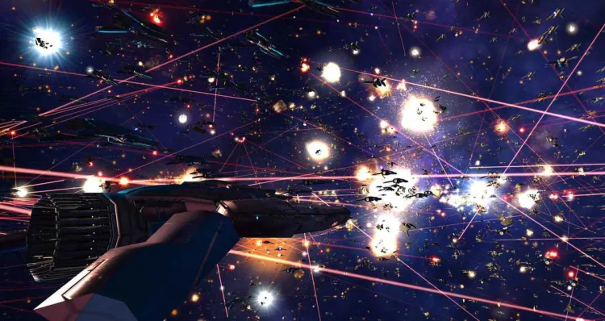
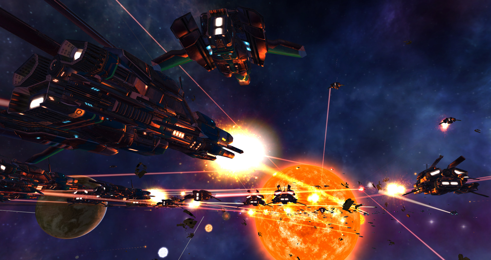
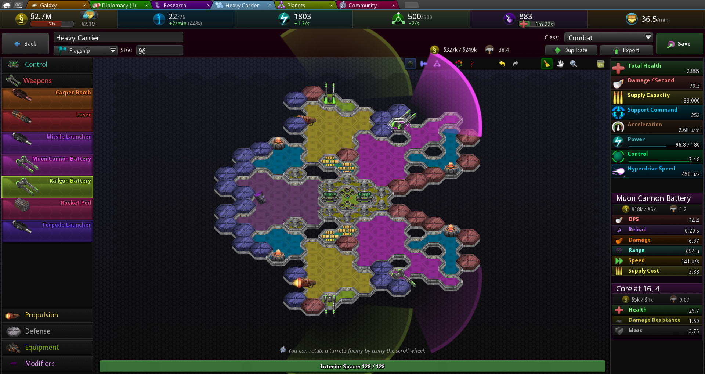
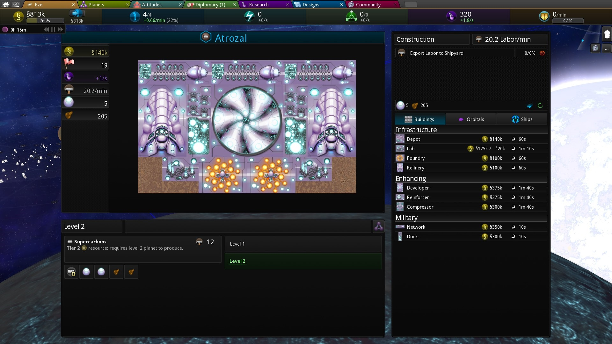
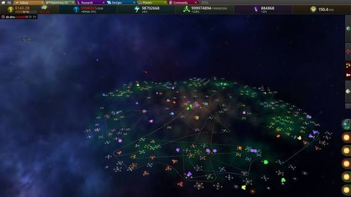
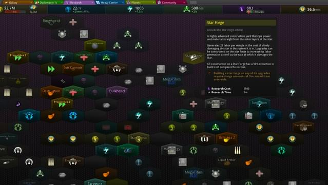

# Star Ruler 2: Foundations

Star Ruler 2: Foundations (SRF) is the spiritual successor of the massive scale 4X/RTS set in space called Star Ruler 2. It was originally marketed to people who played games like Solaris and other space based strategy games like this. But the game leaned way into the logistics side of it to be considered a strategy based RTS game anymore. The issue was that the strategy fan-base along with veteran players of the first game did not enjoy this system, these players had to change how they would think to play the game. I do want to make something clear here, I personally enjoy these space strategy games and I have zero hate towards any of those games, my favorite of them is FreeOrion (check them out, its opensource and the game is awesome and well made).

I learned about this game recently and as a fan of logistic games, such as Factorio or Mindustry (Mindustry is also opensource. check them out to give them support), I thought this game should be brought back from the dead.

I have already added some stuff that should allow new players to have a better time learning to play the game, such as making the tutorial go a bit more on the complex side of the game.

Anyways, Please, feel free to help support this project!

## What is this?
This repository contains the full source code needed to build Star Ruler 2: Foundations, and
all secondary scripts, data files and assets required to run it. It is also a modified version of the game, that fixes its many problems with it.

### Installing the game.
Check [releases](https://github.com/KonradMohr/StarRuler2-Foundations/releases) for the zip with both Windows and Linux.

### Building on Windows

I have successfully tested and made sure the game can run on modern windows compilers. So it should compile fine now.

**INSTRUCTIONS:**

1. Install Visual Studio build tools
```powershell
winget install Microsoft.VisualStudio.2022.BuildTools --override "--wait --add Microsoft.VisualStudio.Workload.VCTools;includeRecommended"
```
2. Go into the project directory, and run:
```powershell
build_windows.bat
```
3. Look in the bin/win64 directory in the project folder, then move the EXE out of it and move it to the project's root folder.
4. If it did not come with the .dll files in the bin/win64, just copy the .dll files from the source to the projects root with:
```powershell
Copy-Item -Path "source\lib\win64\*" -Destination "idk\whatever\yur\project\root\is\lol" -Recurse
```
### Building on Linux

I have successfully fixed the Make-files for this. So you are able to compile this on modern Linux distros!

how to install required dependencies:
**Debian / Ubuntu / Linux Mint:**
```bash
sudo apt install build-essential cmake libpng-dev zlib1g-dev libglew-dev libglu1-mesa-dev libfreetype6-dev libvorbis-dev libogg-dev libopenal-dev libbz2-dev libxrandr-dev libcurl4-openssl-dev
```
**Arch based distros / Manjaro:**
```bash
sudo pacman -S base-devel cmake libpng zlib glew glu freetype2 libvorbis libogg openal bzip2 libxrandr curl
```
**Redhat / Fedora**
```bash
sudo dnf groupinstall "C Development Tools and Libraries"
sudo dnf install cmake libpng-devel zlib-devel glew-devel mesa-libGLU-devel freetype-devel libvorbis-devel libogg-devel openal-soft-devel bzip2-devel libXrandr-devel libcurl-devel
```
Finally go into the project directory and run:
```bash
make -f source/linux/Makefile compile
```
It should produce a .bin file, move this to the projects root then you can run it
**I REPEAT, PUT IT IN THE PROJECT'S ROOT THEN YOU CAN RUN IT**
And that should do it.

### Can I suggest new features? Can I build content for the project to add to the game?
**Yes!** Of course! I want people to help expand this game! From adding small tweaks, to massive overhauls or additions! But it needs to 1. Be thoroughly tested for bugs, 2. Should be in reasonable boundaries of what the game is, (What I mean is I am NOT adding anything crazy and far from the RTS/Stratagy/Logistics genre like a *My Little Pony* update to the game.)

## FAQ
### Can I Play Multiplayer with Steam/GOG versions?
Well it may not work, the original game supported this but because of the modifications to this game, it might prevent it.

You might be able to host your own public game, but I have not tested if this still works, but you can host your own local games. I would recommend using this version only without mixing in the original game. Just to prevent possible crashes and bugs.

I also hope to build a standalone server that can run larger games for long term games.

### Does this include the full game?
Yes it does include most of the game, besides the music. The original studio who owned the game had some issues with copyright with the game's music, because of that, there is no music.
But, if you want to volunteer to make music for the game, I would love that!

### Is there a Community?
Well, kind of? There is the [Steam Forums](https://steamcommunity.com/app/282590/discussions/) for the original game,
and the [Discord Server for Rising Stars](https://discord.gg/9YyXgbh). But they may be dead at this time.
But for this game, I am currently working on a discord server for everyone to join!

### Screenshots
  
  
  
  



## Licensing
Star Ruler 2: Foundations source code is licensed as MIT, art assets are licensed as CC-BY-NC 2.0.

Some third party code is contained in this repository as dependencies. Licenses for those projects are contained in the appropriate source folders.

See the COPYING file for more information.
